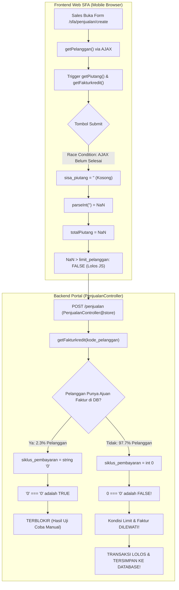

# Laporan Audit Mendalam: Celah Kebocoran Validasi Limit Kredit Pelanggan (Fokus Web & SFA Web)

Laporan audit ini disusun secara khusus untuk menjawab kendala di mana **transaksi penjualan kredit pelanggan sering kali lolos melebihi limit kredit**, padahal saat dilakukan pengujian mandiri (*testing*) sistem berhasil memblokir.

Audit ini berfokus pada alur **Web Platform**:
1. **SFA Web Input**: `SfaControler@createpenjualan` &rarr; `resources/views/sfa/penjualan_create.blade.php` &rarr; `PenjualanController@store`
2. **SFA Web Edit**: `SfaControler@editpenjualan` &rarr; `resources/views/sfa/penjualan_edit.blade.php` &rarr; `PenjualanController@update`
3. **Marketing Portal Web**: `marketing/penjualan/create.blade.php` & `edit.blade.php` (yang menggunakan *backend* controller yang sama).

---

## 1. Ringkasan Eksekutif & Jawaban Inti

> [!IMPORTANT]
> **Mengapa saat Anda uji coba terblokir, tapi di lapangan transaksi sales sering lolos?**
>
> 1. **Penyebab Utama di Backend (`PenjualanController.php` baris 772 & 1237):**
>    Terdapat perbandingan ketat (*strict comparison*) `=== '0'`.
>    Ketika pelanggan **belum pernah memiliki data pengajuan faktur** di tabel `marketing_ajuan_faktur`, fungsi helper `getFakturkredit()` mengembalikan nilai default `$siklus_pembayaran = 0` (**tipe data integer `0`**).
>    Di PHP: `0 === '0'` bernilai **`FALSE`** (karena membandingkan *integer* dengan *string*).
>    - Di database, **56.568 dari 57.886 pelanggan (97,7%)** belum memiliki data pengajuan faktur.
>    - Untuk 97,7% pelanggan ini, kondisi pengecekan limit kredit dan jumlah faktur di *backend* **dilewati total (*bypassed*)**.
>    - Saat Anda menguji coba, Anda memilih pelanggan khusus/sampel yang kebetulan sudah memiliki record pengajuan faktur di database (tipe data terbaca sebagai *string* `'0'`), sehingga `'0' === '0'` bernilai `TRUE` dan berhasil terblokir!
>
> 2. **Penyebab Pendukung di Frontend Web SFA (`penjualan_create` & `penjualan_edit`):**
>    - **Asynchronous Race Condition:** Pemanggilan AJAX `getPiutang` dan `getFakturkredit` berjalan asynchronous di latar belakang, namun tombol submit di-*enable* lebih awal (`buttonEnable()` dipanggil di baris 593). Jika sales menginput cepat atau koneksi lambat, data piutang belum masuk (`""`).
>    - **Celah `NaN` di JavaScript:** Di JS, `parseInt("")` menghasilkan `NaN`. Nilai `NaN + grandtotal` adalah `NaN`. Perbandingan `NaN > limit_pelanggan` selalu menghasilkan **`false`**, sehingga validasi JavaScript di browser sales lolos tanpa memblokir.
>    - **Pengecekan Maksimal Faktur Dinonaktifkan:** Pada `sfa/penjualan_create.blade.php` (baris 491–524), blok kode peringatan otomatis dan pengosongan form saat faktur melebihi batas sengaja **di-comment out**.

---

## 2. Alur Transaksi Web & Letak Celah (*Vulnerabilities*)



---

## 3. Investigasi Detail Temuan Audit

### Temuan 1: *Strict Comparison Bug* di `PenjualanController.php` (Fatal / Critical)
- **File:** [`app/Http/Controllers/PenjualanController.php`](file:///Users/mac/Adam%20Adifa/Pacific/Portal/pacificv4/app/Http/Controllers/PenjualanController.php)
  - Method `store()`: Baris 764 – 778
  - Method `update()`: Baris 1229 – 1243

#### Potongan Kode:
```php
// Baris 764-778 (store) & Baris 1229-1243 (update)
$faktur_kredit = $penjualan->getFakturkredit($kode_pelanggan);
$max_faktur = $faktur_kredit['jml_faktur'];
$unpaid_faktur = $faktur_kredit['unpaid_faktur'];
$siklus_pembayaran = $faktur_kredit['siklus_pembayaran'];

$total_netto = $total_bruto - $total_potongan - $total_potongan_istimewa - $total_penyesuaian;
$total_piutang = $sisa_piutang + $total_netto;

// CELAH FATAL DISINI:
if ($jenis_transaksi == 'K' && $total_piutang > $pelanggan->limit_pelanggan && $siklus_pembayaran === '0') {
    return Redirect::back()->with(messageError('Melebihi Limit, Silahkan Ajukan Penambahan Limit'));
} else if ($jenis_transaksi == 'K' && $total_netto > $pelanggan->limit_pelanggan && $siklus_pembayaran == '1') {
    return Redirect::back()->with(messageError('Melebihi Limit, Silahkan Ajukan Penambahan Limit'));
} else if ($unpaid_faktur > $max_faktur && $siklus_pembayaran === '0') {
    return Redirect::back()->with(messageError('Melebihi Jumlah Faktur Kredit'));
}
```

#### Analisa Teknis:
Perhatikan fungsi [`Penjualan::getFakturkredit()`](file:///Users/mac/Adam%20Adifa/Pacific/Portal/pacificv4/app/Models/Penjualan.php#L427-L435):
```php
$ajuanfaktur = Pengajuanfaktur::where('kode_pelanggan', $kode_pelanggan)
    ->where('status', 1)
    ->orderBy('tanggal', 'desc')
    ->first();
$jml_faktur = $ajuanfaktur != null ? $ajuanfaktur->jumlah_faktur : 1;
$siklus_pembayaran = $ajuanfaktur != null ? $ajuanfaktur->siklus_pembayaran : 0; // Mengembalikan Integer 0
```
Jika pelanggan belum pernah memiliki pengajuan faktur yang disetujui, `$siklus_pembayaran` bernilai `0` (integer).

Evaluasi kondisi PHP:
1. `($siklus_pembayaran === '0')` &rarr; `(0 === '0')` bernilai **`FALSE`**.
2. `($siklus_pembayaran == '1')` &rarr; `(0 == '1')` bernilai **`FALSE`**.
3. `($unpaid_faktur > $max_faktur && $siklus_pembayaran === '0')` &rarr; bernilai **`FALSE`**.

**Dampak:**
Sebanyak **56.568 pelanggan (97.7%)** sama sekali tidak terlindungi oleh filter batas kredit maupun batas jumlah faktur saat transaksi diinput atau diedit melalui Web!

---

### Temuan 2: Asynchronous Race Condition di Frontend Web SFA (`sfa/penjualan_create.blade.php`)
- **File:** [`resources/views/sfa/penjualan_create.blade.php`](file:///Users/mac/Adam%20Adifa/Pacific/Portal/pacificv4/resources/views/sfa/penjualan_create.blade.php) (Baris 549–598 & 1360–1405)

#### Potongan Kode Pemanggilan Pelanggan:
```javascript
// Baris 586-594 di sfa/penjualan_create.blade.php:
getPiutang(kode_pelanggan);      // Asynchronous AJAX call
getFakturkredit(kode_pelanggan); // Asynchronous AJAX call
generatenofaktur();
$('#modalPelanggan').modal('hide');
buttonEnable(); // <--- MASALAH: Tombol submit langsung aktif sebelum AJAX selesai!
```

#### Potongan Kode Validasi Submit Form:
```javascript
// Baris 1362-1366:
const sisa_piutang = $("#sisa_piutang").val();
const gt = $("#grandtotal").val();
const grandtotal = gt != "" ? parseInt(gt.replace(/\./g, '')) : 0;
const totalPiutang = parseInt(sisa_piutang) + parseInt(grandtotal);
let limit_pelanggan = $("#limit_pelanggan").val() == "" ? 0 : $("#limit_pelanggan").val();

// Baris 1395:
} else if (jenis_transaksi == "K" && siklus_pembayaran === '0' && parseInt(totalPiutang) > parseInt(limit_pelanggan)) {
    SwalWarning('nama_produk', 'Melebihi Limit, Silahkan Ajukan Penambahan Limit !');
    return false;
}
```

#### Mekanisme Terjadinya Kebocoran:
1. Saat sales memilih pelanggan (atau halaman baru terbuka), browser mengirim AJAX ke `/pelanggan/{id}/getPiutangpelanggan` dan `/pelanggan/{id}/getFakturkredit`.
2. Tombol submit langsung diaktifkan kembali di baris 593 (`buttonEnable()`), tanpa menunggu *promise/callback* dari `getPiutang` selesai.
3. Jika jaringan seluler sales mengalami jeda (*delay*), input `#sisa_piutang` masih bernilai string kosong `""`.
4. Di JavaScript:
   - `parseInt("")` menghasilkan nilai `NaN` (*Not-a-Number*).
   - `totalPiutang` menjadi `NaN + grandtotal` = `NaN`.
   - Perbandingan logika JavaScript: `NaN > parseInt(limit_pelanggan)` selalu mengembalikan **`false`**!
5. Pengecekan limit di frontend gagal menghentikan submit, dan form langsung meluncur ke backend `PenjualanController@store` (yang di backend pun lolos akibat Temuan 1).

---

### Temuan 3: Celah pada Edit Penjualan Web SFA (`sfa/penjualan_edit.blade.php`)
- **File:** [`resources/views/sfa/penjualan_edit.blade.php`](file:///Users/mac/Adam%20Adifa/Pacific/Portal/pacificv4/resources/views/sfa/penjualan_edit.blade.php) (Baris 593–632 & 1300–1345)

#### Masalah 1: Penanganan Response AJAX Menggunakan Strict Comparison `===` pada Number
Pada baris 604:
```javascript
const siklus_pembayaran = response.data.siklus_pembayaran; // JSON mengembalikan angka: 0
if (unpaid_faktur >= max_faktur && siklus_pembayaran === '0') {
    SwalWarning("nama_pelanggan", "Melebihi Maksimal Faktur Kredit");
    // reset form...
} else {
    $("#jmlfaktur_kredit").text(response.data.unpaid_faktur - 1);
    $("#siklus_pembayaran").val(response.data.siklus_pembayaran);
    $("#max_kredit").val(response.data.jml_faktur);
}
```
Karena API mengembalikan `siklus_pembayaran` bernilai `0` (number), maka di JavaScript:
`0 === '0'` bernilai **`false`**.
Akibatnya blok peringatan dan pembersihan form `unpaid_faktur >= max_faktur` **tidak pernah terpanggil** saat membuka form edit faktur.

#### Masalah 2: Logika Pengecekan Limit saat Edit di `PenjualanController@update`
Di [`PenjualanController.php` baris 1227](file:///Users/mac/Adam%20Adifa/Pacific/Portal/pacificv4/app/Http/Controllers/PenjualanController.php#L1227):
```php
$sisa_piutang = $penjualan->getPiutangpelanggan($penjualan->kode_pelanggan) - $total_netto_penjualan;
```
Perhitungan ini mencoba mengurangi nilai neto faktur lama dari total saldo piutang berjalan untuk menguji nilai barang yang baru. Namun, karena di baris 1237 terdapat bug strict comparison `=== '0'`, kalkulasi ini tidak dieksekusi secara efektif untuk pelanggan tanpa pengajuan faktur.

---

### Temuan 4: Pelanggan dengan `limit_pelanggan` Bernilai `0` atau `NULL`
Berdasarkan pengecekan data di tabel `pelanggan`:
- Pelanggan dengan `limit_pelanggan = NULL`: **9.630 pelanggan**
- Pelanggan dengan `limit_pelanggan = 0`: **38.996 pelanggan**
- Total: **48.626 pelanggan** tidak memiliki limit kredit yang jelas (default 0 atau belum diset).

Ketika transaksi kredit dibuat:
- Karena validasi limit di backend dilewati akibat bug `=== '0'`, pelanggan yang limitnya `0` atau `NULL` justru bebas mengambil kredit berapapun nilainya!
- Tidak ada validasi khusus berbunyi: *"Pelanggan tidak memiliki limit kredit / limit kredit 0 tidak diperbolehkan mengambil transaksi kredit"*.

---

### Temuan 5: Fitur Peringatan Otomatis Faktur Dinonaktifkan (Commented Out)
Di file [`resources/views/sfa/penjualan_create.blade.php` baris 491-518](file:///Users/mac/Adam%20Adifa/Pacific/Portal/pacificv4/resources/views/sfa/penjualan_create.blade.php#L491-L518) dan [`resources/views/marketing/penjualan/create.blade.php` baris 577-597](file:///Users/mac/Adam%20Adifa/Pacific/Portal/pacificv4/resources/views/marketing/penjualan/create.blade.php#L577-L597):
```javascript
// if (unpaid_faktur >= max_faktur && siklus_pembayaran === '0' || unpaid_faktur >= max_faktur &&
//     siklus_pembayaran == '0') {
//     Swal.fire({
//         title: "Oops!",
//         text: "Melebih Maksimal Faktur Kredit !, Maksimal Faktur Kredit Adalah : " + max_faktur,
//         icon: "warning",
//         showConfirmButton: true,
//         didClose: (e) => {
//             $("#no_faktur").val("");
//             ...
//         }
//     });
// }
```
Fitur peringatan dini yang seharusnya langsung memblokir pemilihan pelanggan saat faktur kredit menumpuk sengaja dimatikan / dikomentari. Hal ini menyerahkan seluruh filter kepada pengecekan saat tombol submit ditekan.

---

## 4. Solusi & Rekomendasi Perbaikan Kode

### Solusi 1: Perbaikan Backend `PenjualanController.php` (Wajib & Prioritas Tertinggi)
Ganti seluruh perbandingan tipe ketat `=== '0'` menjadi pengecekan yang aman terhadap tipe data:
`((string)$siklus_pembayaran === '0' || empty($siklus_pembayaran))` atau perbandingan longgar `== '0'`.

**File:** `app/Http/Controllers/PenjualanController.php`
- Pada method `store()` (Ganti baris 772 – 778):
```php
// PERBAIKAN PADA METHOD STORE:
$siklus = (string)$siklus_pembayaran;

if ($jenis_transaksi == 'K') {
    // 1. Blokir jika limit kosong atau 0
    if (empty($pelanggan->limit_pelanggan) || $pelanggan->limit_pelanggan <= 0) {
        return Redirect::back()->with(messageError('Pelanggan belum memiliki limit kredit. Silahkan ajukan limit terlebih dahulu.'));
    }

    // 2. Validasi Limit (Siklus 0 = akumulasi piutang, Siklus 1 = per faktur)
    if ($siklus === '0' && $total_piutang > $pelanggan->limit_pelanggan) {
        return Redirect::back()->with(messageError('Melebihi Limit Kredit, Silahkan Ajukan Penambahan Limit'));
    } else if ($siklus === '1' && $total_netto > $pelanggan->limit_pelanggan) {
        return Redirect::back()->with(messageError('Melebihi Limit Kredit per Faktur, Silahkan Ajukan Penambahan Limit'));
    }

    // 3. Validasi Maksimal Faktur Kredit
    if ($siklus === '0' && $unpaid_faktur >= $max_faktur) {
        return Redirect::back()->with(messageError('Melebihi Jumlah Maksimal Faktur Kredit (' . $max_faktur . ' Faktur)'));
    }
}
```

- Pada method `update()` (Ganti baris 1237 – 1243):
```php
// PERBAIKAN PADA METHOD UPDATE:
$siklus = (string)$siklus_pembayaran;

if ($jenis_transaksi == 'K') {
    if (empty($pelanggan->limit_pelanggan) || $pelanggan->limit_pelanggan <= 0) {
        return Redirect::back()->with(messageError('Pelanggan belum memiliki limit kredit. Silahkan ajukan limit terlebih dahulu.'));
    }

    if ($siklus === '0' && $total_piutang > $pelanggan->limit_pelanggan) {
        return Redirect::back()->with(messageError('Melebihi Limit Kredit, Silahkan Ajukan Penambahan Limit'));
    } else if ($siklus === '1' && $total_netto > $pelanggan->limit_pelanggan) {
        return Redirect::back()->with(messageError('Melebihi Limit Kredit per Faktur, Silahkan Ajukan Penambahan Limit'));
    }

    if ($siklus === '0' && $unpaid_faktur > $max_faktur) {
        return Redirect::back()->with(messageError('Melebihi Jumlah Maksimal Faktur Kredit (' . $max_faktur . ' Faktur)'));
    }
}
```

---

### Solusi 2: Perbaikan Penanganan Asynchronous & Validasi di `sfa/penjualan_create.blade.php`

1. **Sinkronisasi AJAX dengan Promise / Disable Submit hingga Data Lengkap:**
Pastikan `buttonEnable()` hanya dipanggil setelah `getPiutang` dan `getFakturkredit` selesai merespons, bukan dipanggil langsung di fungsi `getPelanggan`.

2. **Antisipasi `NaN` pada Perhitungan Piutang:**
Di fungsi validasi submit ([L1362-L1366](file:///Users/mac/Adam%20Adifa/Pacific/Portal/pacificv4/resources/views/sfa/penjualan_create.blade.php#L1362-L1366)):
```javascript
// Ganti baris 1362-1366 menjadi:
const sisa_piutang_raw = $("#sisa_piutang").val();
const sisa_piutang = sisa_piutang_raw !== "" && !isNaN(sisa_piutang_raw) ? parseInt(sisa_piutang_raw) : 0;
const gt = $("#grandtotal").val();
const grandtotal = gt != "" ? parseInt(gt.replace(/\./g, '')) : 0;
const totalPiutang = sisa_piutang + grandtotal;
const limit_pelanggan = $("#limit_pelanggan").val() != "" ? parseInt($("#limit_pelanggan").val()) : 0;
const siklus_pembayaran = String($("#siklus_pembayaran").val() || '0');
```

3. **Cegah Transaksi Kredit Jika Limit 0:**
```javascript
if (jenis_transaksi == "K" && limit_pelanggan <= 0) {
    SwalWarning('nama_pelanggan', 'Pelanggan belum memiliki limit kredit !');
    return false;
}
```

---

### Solusi 3: Perbaikan di `sfa/penjualan_edit.blade.php`
- Pada baris 604, ubah pengecekan strict equality `siklus_pembayaran === '0'` menjadi:
  `if (unpaid_faktur >= max_faktur && String(siklus_pembayaran) === '0')`
- Pada baris 1301–1306, lakukan normalisasi `parseInt` dengan pengecekan `isNaN` persis seperti pada create agar nilai piutang tidak menjadi `NaN`.

---

### Solusi 4: Konsistensi Return Type pada `Penjualan::getFakturkredit`
Di [`app/Models/Penjualan.php` baris 435](file:///Users/mac/Adam%20Adifa/Pacific/Portal/pacificv4/app/Models/Penjualan.php#L435):
Ubah pengembalian nilai default agar selalu bertipe string:
```php
// Sebelum:
$siklus_pembayaran = $ajuanfaktur != null ? $ajuanfaktur->siklus_pembayaran : 0;

// Sesudah (pastikan konsisten bertipe string):
$siklus_pembayaran = $ajuanfaktur != null ? (string)$ajuanfaktur->siklus_pembayaran : '0';
```
Dengan merubah ini menjadi `'0'`, maka seluruh perbandingan `=== '0'` yang tersebar di controller maupun view akan langsung kompatibel dan bekerja sebagaimana mestinya.

---

## 5. Ringkasan Matriks Titik Celah Web

| No | Komponen / File | Titik Celah | Efek / Dampak | Rekomendasi Solusi |
| :--- | :--- | :--- | :--- | :--- |
| **1** | `PenjualanController@store` (L772) | `siklus_pembayaran === '0'` (Integer vs String) | 97,7% pelanggan tidak tervalidasi limitnya saat simpan | Gunakan `(string)$siklus === '0'` atau normalisasi di Model |
| **2** | `PenjualanController@update` (L1237) | `siklus_pembayaran === '0'` (Integer vs String) | Edit faktur bebas menambah item melampaui limit kredit | Samakan perbaikan tipe data seperti pada `store` |
| **3** | `sfa/penjualan_create.blade.php` (L593) | Race condition AJAX (`buttonEnable` terlalu dini) | Form dapat disubmit sebelum data piutang terisi | Aktifkan tombol hanya setelah seluruh AJAX selesai |
| **4** | `sfa/penjualan_create.blade.php` (L1365) | `parseInt("")` menghasilkan `NaN` | `NaN > limit` menghasilkan `false`, JS lolos | Validasi nilai default `0` jika input kosong/NaN |
| **5** | `sfa/penjualan_edit.blade.php` (L604) | Strict check `siklus_pembayaran === '0'` pada number JSON | Peringatan faktur belum lunas tidak pernah muncul | Gunakan `String(siklus_pembayaran) === '0'` |
| **6** | `Database & Backend` | Pelanggan dengan limit `0` atau `NULL` diizinkan kredit | Toko tanpa limit kredit bisa berutang | Tolak transaksi kredit jika `limit_pelanggan <= 0` |
