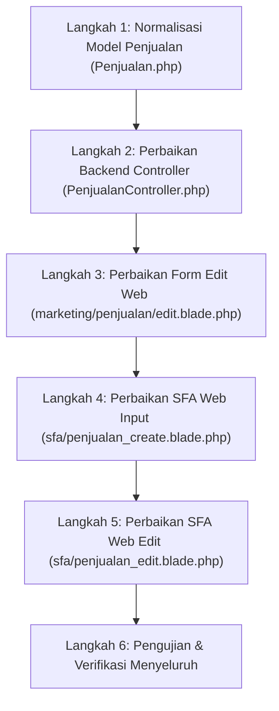

# Panduan & To-Do List Perbaikan Celah Validasi Limit Kredit Pelanggan

Dokumen ini berisi tahapan terstruktur (*step-by-step*) dan daftar periksa (*to-do list*) untuk menutup seluruh celah kebocoran transaksi penjualan kredit yang melebihi batas limit pelanggan pada platform Web Portal dan Web SFA.

---

## 📋 Daftar Berkas yang Dimodifikasi

| No | Berkas | Lapisan | Prioritas | Tujuan Perbaikan |
|---|---|---|---|---|
| 1 | `app/Models/Penjualan.php` | Model (Core) | **Tinggi (P1)** | Menyeragamkan tipe data `$siklus_pembayaran` selalu bertipe string `'0'`. |
| 2 | `app/Http/Controllers/PenjualanController.php` | Backend Controller | **Kritis (P0)** | Memperbaiki perbandingan tipe data (`store` & `update`), validasi limit kosong/0, dan batas faktur. |
| 3 | `resources/views/marketing/penjualan/edit.blade.php` | Frontend Web Portal | **Tinggi (P1)** | Mengaktifkan kembali validasi limit kredit JavaScript yang sebelumnya di-comment out. |
| 4 | `resources/views/sfa/penjualan_create.blade.php` | Frontend SFA Web | **Tinggi (P1)** | Mencegah race condition AJAX dan menangani nilai kosong/`NaN` pada piutang. |
| 5 | `resources/views/sfa/penjualan_edit.blade.php` | Frontend SFA Web | **Sedang (P2)** | Memperbaiki pengecekan tipe data pada response JSON dan kalkulasi piutang edit. |
| 6 | `resources/views/marketing/penjualan/create.blade.php` | Frontend Web Portal | **Sedang (P2)** | Normalisasi penanganan `NaN` pada kalkulasi JavaScript di browser. |

---

## 🚀 Tahapan Perbaikan Terstruktur (Step-by-Step)



---

### Langkah 1: Normalisasi Model `Penjualan.php`
- **File:** `app/Models/Penjualan.php` (baris 435)
- **Tujuan:** Memastikan method helper `getFakturkredit()` selalu mengembalikan `siklus_pembayaran` dalam format string, sehingga aman diproses oleh logika PHP maupun JavaScript.

#### Kode yang Diubah:
```php
// Sebelum (L435):
$siklus_pembayaran = $ajuanfaktur != null ? $ajuanfaktur->siklus_pembayaran : 0;

// Sesudah:
$siklus_pembayaran = $ajuanfaktur != null ? (string)$ajuanfaktur->siklus_pembayaran : '0';
```

- [ ] Ubah nilai default integer `0` menjadi string `'0'` di `app/Models/Penjualan.php`.

---

### Langkah 2: Perbaikan Validasi Backend di `PenjualanController.php`
- **File:** `app/Http/Controllers/PenjualanController.php`
- **Tujuan:** Menjadikan backend sebagai benteng mutlak yang tidak bergantung pada JavaScript browser.

#### A. Pada Method `store()` (Baris 772 – 778):
```php
// GANTI baris 772-778 dengan kode berikut:
$siklus = (string)$siklus_pembayaran;

if ($jenis_transaksi == 'K') {
    // 1. Pelanggan tanpa limit (0 atau NULL) dilarang kredit
    if (empty($pelanggan->limit_pelanggan) || $pelanggan->limit_pelanggan <= 0) {
        return Redirect::back()->with(messageError('Pelanggan belum memiliki limit kredit. Silahkan ajukan limit terlebih dahulu.'));
    }

    // 2. Validasi Limit Piutang Akumulasi (Siklus 0 - Mingguan/Reguler)
    if ($siklus === '0' && $total_piutang > $pelanggan->limit_pelanggan) {
        return Redirect::back()->with(messageError('Melebihi Limit, Silahkan Ajukan Penambahan Limit'));
    }

    // 3. Validasi Limit per Faktur (Siklus 1 - COD)
    if ($siklus === '1' && $total_netto > $pelanggan->limit_pelanggan) {
        return Redirect::back()->with(messageError('Melebihi Limit, Silahkan Ajukan Penambahan Limit'));
    }

    // 4. Validasi Maksimal Jumlah Faktur Kredit Belum Lunas
    if ($siklus === '0' && $unpaid_faktur >= $max_faktur) {
        return Redirect::back()->with(messageError('Melebihi Jumlah Faktur Kredit'));
    }
}
```

#### B. Pada Method `update()` (Baris 1237 – 1243):
```php
// GANTI baris 1237-1243 dengan kode berikut:
$siklus = (string)$siklus_pembayaran;

if ($jenis_transaksi == 'K') {
    // 1. Pelanggan tanpa limit (0 atau NULL) dilarang kredit
    if (empty($pelanggan->limit_pelanggan) || $pelanggan->limit_pelanggan <= 0) {
        return Redirect::back()->with(messageError('Pelanggan belum memiliki limit kredit. Silahkan ajukan limit terlebih dahulu.'));
    }

    // 2. Validasi Limit Piutang Akumulasi saat Edit
    if ($siklus === '0' && $total_piutang > $pelanggan->limit_pelanggan) {
        return Redirect::back()->with(messageError('Melebihi Limit, Silahkan Ajukan Penambahan Limit'));
    }

    // 3. Validasi Limit per Faktur saat Edit
    if ($siklus === '1' && $total_netto > $pelanggan->limit_pelanggan) {
        return Redirect::back()->with(messageError('Melebihi Limit, Silahkan Ajukan Penambahan Limit'));
    }

    // 4. Validasi Maksimal Faktur Kredit saat Edit
    if ($siklus === '0' && $unpaid_faktur > $max_faktur) {
        return Redirect::back()->with(messageError('Melebihi Jumlah Faktur Kredit'));
    }
}
```

- [ ] Terapkan perbaikan validasi pada method `store()` di `PenjualanController.php`.
- [ ] Terapkan perbaikan validasi pada method `update()` di `PenjualanController.php`.

---

### Langkah 3: Mengaktifkan Validasi Limit pada Edit Form Web Portal
- **File:** `resources/views/marketing/penjualan/edit.blade.php` (baris 1748–1757)
- **Tujuan:** Menutup celah di mana sales/admin dapat menambah barang tak terbatas pada form edit faktur.

#### Kode yang Diubah:
Buka komentar (*uncomment*) dan sesuaikan parsing angkanya:
```javascript
// Aktifkan kembali pengecekan limit pada submit form edit:
const sisa_piutang_val = $("#sisa_piutang").val();
const sisa_piutang_num = (sisa_piutang_val !== "" && !isNaN(sisa_piutang_val)) ? parseInt(sisa_piutang_val) : 0;
const totalPiutangEdit = sisa_piutang_num + grandtotal;
const limitPelangganEdit = $("#limit_pelanggan").val() !== "" ? parseInt($("#limit_pelanggan").val()) : 0;
const siklusEdit = String($("#siklus_pembayaran").val() || '0');

if (jenis_transaksi == "K" && siklusEdit === '0' && totalPiutangEdit > limitPelangganEdit) {
    SwalWarning('nama_produk', 'Melebihi Limit, Silahkan Ajukan Penambahan Limit !');
    return false;
} else if (jenis_transaksi == "K" && siklusEdit === '1' && grandtotal > limitPelangganEdit) {
    SwalWarning('nama_produk', 'Melebihi Limit, Silahkan Ajukan Penambahan Limit !');
    return false;
}
```

- [ ] Aktifkan dan amankan validasi limit kredit pada `resources/views/marketing/penjualan/edit.blade.php`.

---

### Langkah 4: Perbaikan Asynchronous & Nilai `NaN` di SFA Web Input
- **File:** `resources/views/sfa/penjualan_create.blade.php`
- **Tujuan:** Mencegah pengiriman form sebelum data piutang terambil, dan mencegah bypass logika jika angka bernilai `NaN`.

#### A. Sinkronisasi Tombol Submit (Baris 586–594):
Hapus pemanggilan `buttonEnable()` dini di fungsi `getPelanggan`:
```javascript
// Sebelum (L593):
// getPiutang(kode_pelanggan);
// getFakturkredit(kode_pelanggan);
// generatenofaktur();
// $('#modalPelanggan').modal('hide');
// buttonEnable(); // <-- HAPUS BARIS INI agar tombol tidak aktif sebelum AJAX selesai

// Sesudah:
// buttonEnable() hanya dipanggil di dalam success callback getFakturkredit() & getPiutang()
```

#### B. Amankan Perhitungan Piutang pada Submit (Baris 1362–1366):
```javascript
// Ganti baris 1362-1366 dengan:
const sisa_piutang_raw = $("#sisa_piutang").val();
const sisa_piutang = (sisa_piutang_raw !== "" && !isNaN(sisa_piutang_raw)) ? parseInt(sisa_piutang_raw) : 0;
const gt = $("#grandtotal").val();
const grandtotal = gt != "" ? parseInt(gt.replace(/\./g, '')) : 0;
const totalPiutang = sisa_piutang + grandtotal;
const limit_pelanggan = $("#limit_pelanggan").val() != "" ? parseInt($("#limit_pelanggan").val()) : 0;
const siklus_pembayaran = String($("#siklus_pembayaran").val() || '0');
```

#### C. Tolak Kredit jika Limit Pelanggan 0:
```javascript
if (jenis_transaksi == "K" && limit_pelanggan <= 0) {
    SwalWarning('nama_pelanggan', 'Pelanggan belum memiliki limit kredit, silahkan ajukan limit terlebih dahulu !');
    return false;
}
```

- [ ] Hapus pemanggilan `buttonEnable()` prematur di `getPelanggan` pada `sfa/penjualan_create.blade.php`.
- [ ] Amankan parsing `parseInt` dengan validasi `!isNaN` pada submit `sfa/penjualan_create.blade.php`.
- [ ] Tambahkan validasi penolakan transaksi kredit untuk limit 0 / kosong pada frontend SFA.

---

### Langkah 5: Perbaikan di SFA Web Edit
- **File:** `resources/views/sfa/penjualan_edit.blade.php`
- **Tujuan:** Menjamin response JSON numerik `0` tidak gagal saat dibandingkan di JavaScript.

#### A. Pengecekan Faktur Kredit (Baris 604):
```javascript
// Sebelum:
if (unpaid_faktur >= max_faktur && siklus_pembayaran === '0')

// Sesudah:
if (unpaid_faktur >= max_faktur && String(siklus_pembayaran) === '0')
```

#### B. Normalisasi Nilai Submit (Baris 1301–1306):
Gunakan fungsi konversi yang tahan terhadap `NaN` seperti pada langkah 4B.

- [ ] Ubah perbandingan tipe data di `sfa/penjualan_edit.blade.php` baris 604.
- [ ] Terapkan penanganan `NaN` pada perhitungan piutang edit di `sfa/penjualan_edit.blade.php`.

---

## 🧪 Langkah 6: Skenario Pengujian & Checklist Verifikasi

Setelah semua kode di atas diterapkan, lakukan pengujian berikut untuk memastikan celah 100% tertutup:

- [ ] **Test Case 1 (Web Portal Create - Melebihi Limit):**
  Pilih pelanggan `BDG-01449` (Mulyana Atas, Limit 4 jt, Piutang 450 rb). Masukkan order Rp 5 jt kredit.
  *Hasil yang diharapkan:* Muncul pop-up JavaScript "Melebihi Limit, Silahkan Ajukan Penambahan Limit !" dan form batal terkirim.
- [ ] **Test Case 2 (Web Portal Edit - Melebihi Limit):**
  Buka faktur kredit yang sudah ada milik pelanggan dengan limit tertentu. Tambahkan item hingga total neto melampaui limit. Klik Submit.
  *Hasil yang diharapkan:* Terblokir oleh validasi edit (baik di frontend maupun backend).
- [ ] **Test Case 3 (Uji Backend Direct / Bypass JS):**
  Uji kirim data ke `PenjualanController@store` langsung dengan nilai melebihi limit.
  *Hasil yang diharapkan:* Redirect back dengan error flash message "Melebihi Limit, Silahkan Ajukan Penambahan Limit" dari backend.
- [ ] **Test Case 4 (Pelanggan Limit 0 / Tanpa Limit):**
  Pilih pelanggan dengan limit 0 atau kosong, pilih jenis transaksi Kredit (`K`).
  *Hasil yang diharapkan:* Terblokir dengan pesan "Pelanggan belum memiliki limit kredit".
- [ ] **Test Case 5 (Pelanggan Siklus 1 - COD):**
  Pilih pelanggan dengan siklus bayar COD (Siklus 1). Coba masukkan order 1 faktur yang nilainya melebihi limit.
  *Hasil yang diharapkan:* Terblokir oleh validasi limit per faktur.
